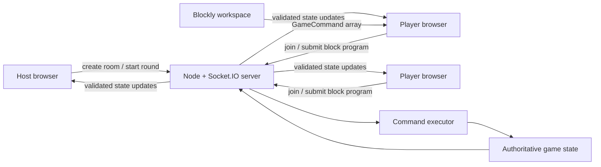
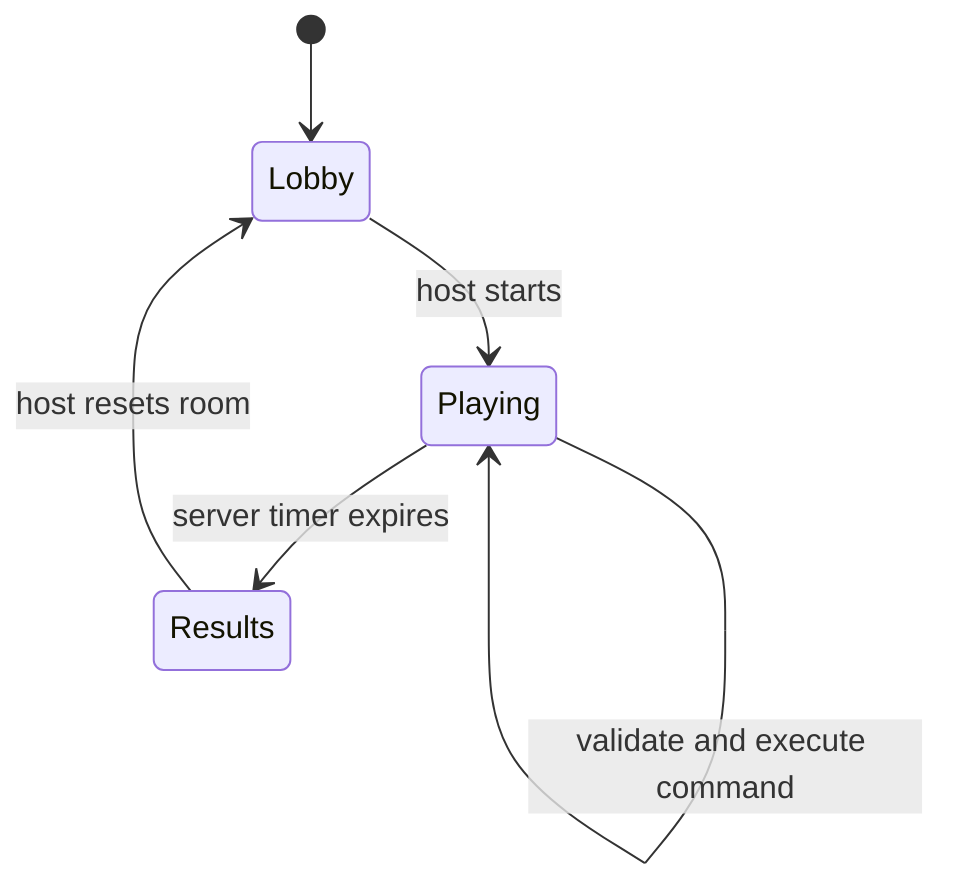

# Pumpkin Stack Game — Prototype Architecture

## Implementation status

The first playable milestone was implemented on 2026-10-13 in the Codex project workspace. It includes the TypeScript monorepo, React and Blockly client, Socket.IO authoritative server, in-memory rooms, PVP and PVE transfers, server timers, final scoring, a projection-friendly TA dashboard, live player program progress, large PVE boss health, semantic command animations, responsive styling, placeholder animated pumpkin art, and automated unit and socket-integration coverage.

Final verification after the host-view work: 25 tests passed; coverage measured 97.05% statements, 82.30% branches, 100% functions, and 97.05% lines. Type checking and the production build passed. Production npm dependencies reported zero known audit vulnerabilities.

## Recommendation

Build the first prototype as a small TypeScript monorepo with three parts:

1. A **React browser client** for the lobby, Blockly workspace, pumpkin stacks, timer, scores, and pixel-art animations.
2. A **Node.js real-time server** using Socket.IO. The server owns rooms, players, timers, pumpkin stacks, command execution, transfers, and scoring.
3. A **shared package** containing game types, command definitions, event payloads, validation schemas, and pure scoring functions used by both client and server.

The prototype keeps rooms in server memory and does not require a database, accounts, Redis, or a game engine.

## Why this structure

- TypeScript across the client, server, and shared package reduces context switching and catches mismatched event data.
- Socket.IO handles low-latency browser updates, reconnects, and room broadcasts without requiring a custom networking layer.
- Blockly supplies accessible drag-and-drop programming blocks and can later generate text code.
- React is well suited to the lobby, controls, scores, and block editor.
- CSS sprite animations are enough for a 2D stack game; Phaser would add complexity before the prototype needs it.
- An authoritative server gives every browser one trusted version of the game state.

## System diagram



## Suggested repository layout

```text
pumpkin-stack-game/
├── apps/
│   ├── client/
│   │   └── src/
│   │       ├── components/
│   │       ├── game/
│   │       ├── blocks/
│   │       ├── animations/
│   │       ├── screens/
│   │       └── socket/
│   └── server/
│       └── src/
│           ├── rooms/
│           ├── game/
│           ├── commands/
│           ├── socket/
│           └── index.ts
├── packages/
│   └── shared/
│       └── src/
│           ├── types.ts
│           ├── commands.ts
│           ├── events.ts
│           ├── scoring.ts
│           └── validation.ts
├── package.json
└── tsconfig.base.json
```

Use npm workspaces so the project remains familiar and requires one package manager.

## Client architecture

### Screens

1. **Home:** Enter a display name and room code, or create a room as host.
2. **Lobby:** Show players, game mode, and a host-only Start button.
3. **Game:** Show the player's stack, temporary queue, Blockly workspace, Run button, timer, score, and small opponent summary.
4. **Results:** Show PVP ranking or the PVE class-versus-witch result.

### Main components

- `RoomForm` — creates or joins a room.
- `Lobby` — player list and host controls.
- `BlocklyEditor` — converts blocks into a `GameCommand[]` payload.
- `PumpkinStack` — renders the local stack from bottom to top.
- `PumpkinQueue` — renders temporary FIFO storage.
- `CommandTimeline` — shows queued, running, completed, and failed commands.
- `ScoreBoard` — displays live or final mode-specific scores.
- `RoundTimer` — renders the server-provided end time.
- `WitchPanel` — PVE witch stack, multiplier, score, and animations.

### Client state

Keep server game state in one small store. The client may store UI-only state such as open panels and the unfinished Blockly workspace locally. It must not calculate authoritative transfers, scores, or winners.

## Block-program architecture

Blockly blocks compile into a safe command list rather than executable JavaScript.

```ts
type GameCommand =
  | { type: "PEEK_TOP" }
  | { type: "POP_TO_QUEUE" }
  | { type: "DEQUEUE_TO_STACK" }
  | { type: "SEND_TOP" };
```

Example block program:

```text
repeat 3 times
  pop top pumpkin into queue

move front of queue back to stack
send top pumpkin
```

The client serializes this into data. The server validates the list and executes one command at a time. This avoids running student-authored JavaScript on the server.

For the first prototype, use a small block set with sequential execution. Add conditions and loops only after the basic round works.

## Server architecture

### Server-owned state

```ts
type Room = {
  code: string;
  hostPlayerId: string;
  mode: "PVP" | "PVE";
  phase: "LOBBY" | "PLAYING" | "RESULTS";
  roundEndsAt: number | null;
  players: Map<string, PlayerState>;
  witch: WitchState | null;
};
```

Each `PlayerState` contains the player's name, connection status, pumpkin stack, temporary queue, submitted command list, and current command index.

### Room manager

The room manager creates short room codes, joins players, assigns the host, removes expired rooms, and looks up the room for each socket. The prototype stores rooms in a `Map` in one Node process.

### Game engine

The game engine is a set of plain functions that:

- creates initial pumpkin stacks;
- validates commands against the current state;
- applies stack and queue operations;
- selects a random PVP recipient;
- transfers a PVE pumpkin to the witch;
- calculates PVP and PVE scores;
- determines the winner when time expires.

Keep these functions independent from Socket.IO so they are easy to test.

### Command executor

When a player presses Run:

1. The server validates the full command list and its maximum length.
2. The server stores the program on that player's state.
3. A room scheduler executes ready commands at their configured time costs.
4. After each operation, the server broadcasts a small event describing the change.
5. Clients animate the event, then reconcile with the latest server state.

Use server timestamps rather than trusting browser timers.

## Real-time event contract

### Client to server

```text
room:create
room:join
game:set-mode
game:start
program:submit
player:request-state
```

### Server to client

```text
room:joined
room:state
game:started
command:started
command:resolved
game:state
game:finished
game:error
```

Every command includes a room identifier and player identifier derived from the socket session. The server ignores client-supplied scores, pumpkin values, targets, and completion times.

## Prototype game-state flow



## Pixel-art implementation

Use small sprite sheets or individual PNG/WebP assets rendered in React components. CSS keyframes can handle push, pop, queue roll, transfer flight, wobble, and evil transformation animations.

The server sends semantic events such as `PUMPKIN_TRANSFERRED`; the client decides how that event looks. Game rules therefore remain independent from animation timing.

Respect reduced-motion settings by replacing movement with short fades or instant state changes.

## Prototype defaults

These defaults are proposed for the first playable build and can be tuned:

- 2–30 players per room
- 90-second round
- 8 pumpkins per player
- Values chosen randomly from -5 through +5
- 20 commands maximum per submitted program
- One command resolves every 500 milliseconds
- PVP target selected uniformly from connected opponents
- In-memory rooms expire after inactivity
- Display names only; no accounts

## Reliability and safety boundaries

- Validate names, room codes, modes, and command arrays on the server.
- Limit name length and command count.
- Reject impossible operations, such as popping an empty stack.
- Escape player names when rendered.
- On reconnect, restore a player using an opaque reconnect token stored in that browser.
- Do not accept executable code in the blocks-first prototype.
- Treat the server state as authoritative after every animation.

## What the first prototype includes

- Create and join a room by code
- Host selects PVP or PVE
- Host starts one timed round
- Random starting pumpkin stacks
- Visible stack and temporary queue
- Blockly editor with four primitive operations
- Submit and execute a command sequence over time
- Random-opponent transfer in PVP
- Transfer to the witch in PVE
- Correct final scoring and result screen
- Simple placeholder pixel-art pumpkins and basic animations

## Deliberately deferred

- Text-coding difficulty mode
- Witch attacks or AI
- Accounts and permanent profiles
- Database and match history
- Matchmaking
- Spectators
- Power-ups
- Chat
- Multiple server instances and Redis
- Advanced Blockly conditions and loops
- Final art and audio

## Build order

1. Create shared types and pure stack/queue/scoring functions.
2. Build a local single-player screen that renders and manipulates one stack.
3. Add Blockly and compile blocks into `GameCommand[]`.
4. Add the Socket.IO server and one shared room.
5. Add room codes, lobby, and host controls.
6. Add timed command execution and broadcasts.
7. Add PVP transfer and scoring.
8. Add PVE witch transfer and multiplied scoring.
9. Add results, reconnect behavior, animations, and polish.

The first milestone is two browser tabs joining one room, submitting block programs, transferring pumpkins, and receiving the same final result from the server.
